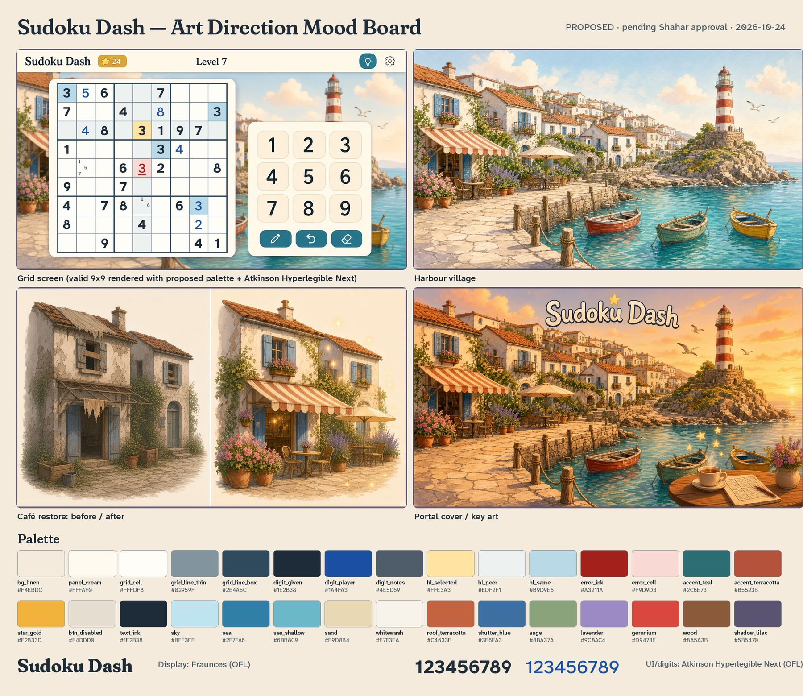

# Sudoku Dash — Art Direction Proposal

**Status: APPROVED by Shahar on 2026-10-24 (as proposed). Production assets: see [STYLE_GUIDE.md](STYLE_GUIDE.md).** Nothing here is integrated into the game yet. No game code, scenes or export settings were changed. `docs/.gdignore` keeps everything under `docs/` out of the Godot import and export.

- Author: SD Art (art lead), 2026-10-24
- Target: Godot 4.3, web export (1280x720 landscape, `canvas_items` stretch), CrazyGames first, then Poki and GameDistribution
- Audience: women 35-65+. Readability is the first priority and cosiness the second.
- Mood board: [`moodboard/00_combined_moodboard.jpg`](moodboard/00_combined_moodboard.jpg)



## 1. Style in one paragraph
**Painterly cozy harbour.** The look is soft hand-painted gouache with thin warm-brown outlines (never black), set in late-afternoon golden-hour light. Shadows are lilac (`#5B5470`), never grey or black. Materials read clearly: whitewashed plaster, terracotta tiles, sun-faded blue shutters, rope, oak planks and worn cobbles. It mixes a Cornish fishing harbour with a Mediterranean hillside town. The mood is warm, calm and premium cozy, in the same family as Moon Active and Playtika meta layers, with less noise and fewer sparkles. **UI is the exception.** Grid, digits and buttons are drawn flat and crisp (StyleBoxFlat, rounded 14-22 px corners, soft lilac drop shadows) so the puzzle never competes with the painting. Painted art lives behind the grid and in the village, while flat UI sits on top.

## 2. Palette
Hex values and roles (machine-readable copy: [`palette.json`](palette.json)):

| Token | Hex | Role |
|---|---|---|
| `bg_linen` | `#F4EBDC` | App background behind panels (replaces flat #BFE3EF on menus) |
| `panel_cream` | `#FFFAF0` | Panels, modals, keypad tiles |
| `grid_cell` | `#FFFDF8` | Grid cell paper |
| `grid_line_thin` | `#82959F` | Thin cell lines |
| `grid_line_box` | `#2E4A5C` | 3x3 box lines + grid border |
| `digit_given` | `#1E2B38` | Given digits (Bold 700) |
| `digit_player` | `#1A4FA3` | Player digits (Regular 450-500) |
| `digit_notes` | `#4E5D69` | Pencil notes |
| `hl_selected` | `#FFE3A3` | Selected cell (sunlit butter) |
| `hl_peer` | `#EDF2F1` | Row/column/box peers |
| `hl_same` | `#B9D9E6` | Same-digit cells |
| `error_ink` | `#A3211A` | Wrong digit (+ underline + shake, never colour-only) |
| `error_cell` | `#F9D9D3` | Wrong-digit cell tint |
| `accent_teal` | `#2C6E73` | Primary buttons (Play, Resume, Hint) |
| `accent_terracotta` | `#B5523B` | Secondary CTA / Buy / rewarded |
| `star_gold` | `#F2B33D` | Stars, coins, rewards (with navy text/outline) |
| `btn_disabled` | `#E4DDD0` | Locked/disabled button fill (with lock icon) |
| `text_ink` | `#1E2B38` | Body/UI text |
| `sky` | `#BFE3EF` | Village sky (kept; matches splash/body bg) |
| `sea` | `#2F7FA6` | Deep harbour water |
| `sea_shallow` | `#6BB8C9` | Shallows/turquoise |
| `sand` | `#E9D8B4` | Quay, sand, stone paths |
| `whitewash` | `#F7F3EA` | Cottage walls |
| `roof_terracotta` | `#C4633F` | Roofs, awning stripes |
| `shutter_blue` | `#3E6FA3` | Shutters, doors, boat trim |
| `sage` | `#8BA37A` | Foliage, olive trees |
| `lavender` | `#9C8AC4` | Lavender beds, dusk accents |
| `geranium` | `#D9473F` | Flowers, lighthouse stripes |
| `wood` | `#8A5A3B` | Dock planks, boats, rope posts |
| `shadow_lilac` | `#5B5470` | Shadow tint (never pure black) |

### Contrast (WCAG 2.x relative luminance)
Text has to reach AA, which is 4.5:1 for normal text. Large digits only need 3:1, but every digit pair here also clears 4.5:1, and digits on plain cells clear AAA at 7:1. Non-text UI such as grid lines needs 3:1.

| Foreground | Background | Ratio | Needed | Result |
|---|---|---|---|---|
| digit_given | grid_cell | 14.17:1 | 4.5 | PASS |
| digit_given | hl_selected | 11.50:1 | 4.5 | PASS |
| digit_given | hl_peer | 12.74:1 | 4.5 | PASS |
| digit_given | hl_same | 9.69:1 | 4.5 | PASS |
| digit_given | error_cell | 10.90:1 | 4.5 | PASS |
| digit_player | grid_cell | 7.68:1 | 4.5 | PASS |
| digit_player | hl_selected | 6.23:1 | 4.5 | PASS |
| digit_player | hl_peer | 6.90:1 | 4.5 | PASS |
| digit_player | hl_same | 5.25:1 | 4.5 | PASS |
| digit_player | error_cell | 5.91:1 | 4.5 | PASS |
| digit_notes | grid_cell | 6.68:1 | 4.5 | PASS |
| digit_notes | hl_selected | 5.42:1 | 4.5 | PASS |
| digit_notes | hl_peer | 6.00:1 | 4.5 | PASS |
| digit_notes | hl_same | 4.57:1 | 4.5 | PASS |
| digit_notes | error_cell | 5.14:1 | 4.5 | PASS |
| error_ink | grid_cell | 7.40:1 | 4.5 | PASS |
| error_ink | hl_selected | 6.01:1 | 4.5 | PASS |
| error_ink | hl_peer | 6.66:1 | 4.5 | PASS |
| error_ink | hl_same | 5.07:1 | 4.5 | PASS |
| error_ink | error_cell | 5.70:1 | 4.5 | PASS |
| grid_line_box | grid_cell | 9.18:1 | 3 | PASS |
| grid_line_thin | grid_cell | 3.06:1 | 3 | PASS |
| panel_cream | accent_teal | 5.63:1 | 4.5 | PASS |
| panel_cream | accent_terracotta | 4.77:1 | 4.5 | PASS |
| text_ink | star_gold | 7.74:1 | 4.5 | PASS |
| text_ink | panel_cream | 13.85:1 | 4.5 | PASS |
| text_ink | bg_linen | 12.18:1 | 4.5 | PASS |
| text_ink | btn_disabled | 10.67:1 | 4.5 | PASS |
| digit_notes | btn_disabled | 5.03:1 | 4.5 | PASS |
| text_ink | sky | 10.60:1 | 4.5 | PASS |

Digits on a plain cell: given **14.2:1**, player **7.7:1**, error **7.4:1**, notes **6.7:1**. The worst case is player digits on the same-digit highlight at 5.25:1, which still passes AA for small text.

### Colour-blind safety
The three digit inks were simulated for deuteranopia, protanopia and tritanopia using Machado 2009 matrices. Values are CIELAB ΔE, where above roughly 20 means clearly distinct:

```
deutan given/player dE=46 player/error dE=95 given/error dE=58 sel/peer 36 same/peer 16 teal/terra 48
protan given/player dE=43 player/error dE=76 given/error dE=38 sel/peer 35 same/peer 12 teal/terra 32
tritan given/player dE=26 player/error dE=96 given/error dE=85 sel/peer 18 same/peer 18 teal/terra 87
```

The rules below mean colour never carries meaning alone:
- **Given vs player:** givens are **Bold 700** and player digits are **Regular 450-500**. That is a shape difference as well as a hue difference. Tritan ΔE is the lowest pair at 26, and the weight difference covers it.
- **Error:** red ink, plus a 3 px underline, a light red cell tint and a short shake. The conflicting peer gets a thin outline.
- **Selected vs peers vs same digit:** these are separated by lightness (butter vs near-white vs mid blue), not by hue alone.
- **Stars and coins:** always gold with a navy outline or text (7.7:1), never gold on cream.
- **Locked buttons:** `btn_disabled` fill, ink text **and a padlock icon**. This replaces today's grey-on-grey "Locked" label.

## 3. Fonts (both SIL OFL 1.1, free for commercial use and embedding)
| Use | Font | Why | Link | License |
|---|---|---|---|---|
| Display (title, headers, level names, results) | **Fraunces** (variable: opsz, wght, SOFT, WONK). Use SOFT=100, WONK=0, wght 600-700 | Warm, soft "old-style" serif that reads as premium cozy and suits the café and seaside mood | https://fonts.google.com/specimen/Fraunces · https://github.com/undercasetype/Fraunces | OFL 1.1 (verified in `OFL.txt` upstream) |
| UI + grid digits | **Atkinson Hyperlegible Next** (variable wght 200-800) | Designed by the Braille Institute for low-vision legibility. Digits are very distinct (1/7, 3/8, 6/9 and 5/6 can't be confused) and work well at large sizes for a 35-65+ audience | https://fonts.google.com/specimen/Atkinson+Hyperlegible+Next · https://github.com/googlefonts/atkinson-hyperlegible-next | OFL 1.1 (verified in `OFL.txt` upstream) |

Size budget: AHN variable is 115 KB and Fraunces variable is 360 KB. **Recommendation:** ship a Latin-subset static Fraunces SemiBold (about 40-60 KB) plus the AHN variable, about 0.2 MB total. Both work in Godot 4.3 as `FontFile`/`FontVariation`, with MSDF optional for crisp scaling. Grid digit size should be about 68-72% of cell height. Today's live build already uses large digits, so keep that.

## 4. CC0 base pack
**Pick: [Kenney "Game Icons"](https://kenney.nl/assets/game-icons) (CC0 1.0, confirmed on the asset page) for UI glyphs only:** star, gear/settings, sound on/off, undo, lightbulb hint, pencil, padlock, home and arrows. Recolour to `text_ink` and `panel_cream`. Fallback: [Kenney "UI Pack"](https://kenney.nl/assets/ui-pack) (CC0) for icons only. Its button art is too generic.

**Why the scene art is self-generated rather than taken from a pack:** no CC0 pack matches a painterly European harbour with *before/after* states of the same buildings. Kenney's kits are flat or low-poly and would look cheap next to painted key art, and portal covers must be "art we own", not screenshots. The plan is to generate each restorable object (dock, boats, flowerbeds, lighthouse, café, matching `game/profile.gd` TASKS) as **separate before/after sprites on a transparent background** in the locked style below. Then a human pass cleans edges and keeps colours on-palette. UI panels and buttons stay procedural (`StyleBoxFlat`) at zero texture cost.

## 5. Locked generation style (prompt prefix)
> Cozy casual mobile game art, painterly 2D illustration with soft hand-painted gouache textures and thin warm-brown outlines, gentle golden-hour lighting, soft lilac shadows, premium cozy mood, European seaside harbour (Cornish fishing village x Mediterranean town): whitewashed and pale stone cottages, terracotta roofs, blue shutters, sky blue #BFE3EF, turquoise sea, sand, sage, lavender, geranium accents. No text unless specified, no logos.

Always pass `moodboard/02_harbour_village.jpg` as the style reference image.

## 6. Mood board
| # | File | Notes |
|---|---|---|
| 1 | [`01_grid_screen.jpg`](moodboard/01_grid_screen.jpg) | Generated background and UI chrome. **The 9x9 grid is rendered with code** (`tools/grid_overlay.py`) from a real puzzle (`9x9_t1_0000`), using the exact palette and AHN font. That keeps the digits sharp and the grid valid, which image generation can't guarantee. It shows given and player digits, the selected cell, peers, same-digit highlights, an error with underline and pencil notes. The keypad, the teal icon buttons (notes/undo/erase), the gold star pill, the hint bulb and the settings gear are generated. |
| 2 | [`02_harbour_village.jpg`](moodboard/02_harbour_village.jpg) | Village target look. The quay foreground is left open for task markers. |
| 3 | [`03_restore_before_after.jpg`](moodboard/03_restore_before_after.jpg) | Harbour café, neglected vs restored. Restoring should change saturation, light *and* silhouette (awning, tables, flowers). |
| 4 | [`04_cover_key_art.jpg`](moodboard/04_cover_key_art.jpg) | Portal cover direction (16:9). The title is the only text, with no borders or buttons, per `PORTAL_CHECKLIST.md`. The final covers (1920x1080, 800x1200, 800x800) need re-composing and hand-set title lettering. |

## 7. Current state vs proposed
The current state comes from live-build screenshots taken on 2026-10-24 and `ui/*.gd`.

| Area | Current | Proposed |
|---|---|---|
| Grid digits | Already strong: dark givens `#1F2F3A`, blue player `#2A6FDB`, red errors, light-blue highlights, large digits and generous keypad tiles | **Keep the structure.** Deepen player blue `#2A6FDB` to `#1A4FA3` (4.7:1 to 7.7:1) and error red `#D23C3C` to `#A3211A` (4.6:1 to 7.4:1), make givens bold and player digits regular, add the error underline, use a butter-yellow selected cell and switch to the AHN font |
| Harbour | Flat placeholder rectangles (`harbour_view.gd`) | Painted background plus per-task before/after sprites, with a restore tween and sparkle |
| Buttons | Drab grey with low contrast. Play looks disabled, and Buy/Locked and T1-T4 are weak | Teal primary (cream text 5.6:1), terracotta secondary/Buy (4.8:1), cream tiles for keypad and tier chips with a teal selected state. Locked = `btn_disabled`, ink text and a padlock icon |
| Header | "Tokens 1" wraps, and the Hint button is clipped and crowds "Mistakes 0/3" | Icon pills (star, coin, token) with numbers in a fixed-width top bar. Hint becomes a round icon button with its own slot. Mistakes shown as 3 small hearts or dots in the grid header |
| Settings | No settings or sound button | Gear plus sound toggle in the top-right of every screen (Kenney icons) |
| Loader/branding | Placeholder icon and splash, which looks unpolished | Lighthouse-and-star app icon plus a painted splash. Boot bg stays `#BFE3EF` so there's no colour flash |
| Background | Flat `#BFE3EF` | Linen `#F4EBDC` on menus, and a blurred, dimmed village behind the grid |

## 8. Web size budget
The current web build is about **39.5 MB**, mostly the engine wasm and pck. Proposed art budget: **≤ 5 MB added**.
- Village background at 1920x1080, lossy WebP or VRAM-compressed: about 400-700 KB
- 5 tasks x before/after sprites, trimmed and atlas-packed: about 1.5-2.5 MB
- Fonts: about 0.2 MB. Icons are SVG or small PNGs: about 50 KB
- UI panels are procedural: 0 KB

Mood board and doc images stay in `docs/` and are excluded via `docs/.gdignore`, so they are never imported or shipped.

## 9. Next steps (after approval)
1. Approve or adjust the palette, fonts and style. Shahar decides.
2. Generate the five task before/after sprites and one village background in the locked style, then do a cleanup pass.
3. Build a Godot `Theme` (`.tres`) from the palette tokens, with the fonts and StyleBoxFlat buttons. Grid colour constants get swapped in `grid_view.gd`. That part belongs to the dev, not art.
4. Covers ×3 and the icon/splash.

Generated assets and licenses are logged in [`LICENSES.md`](LICENSES.md).
