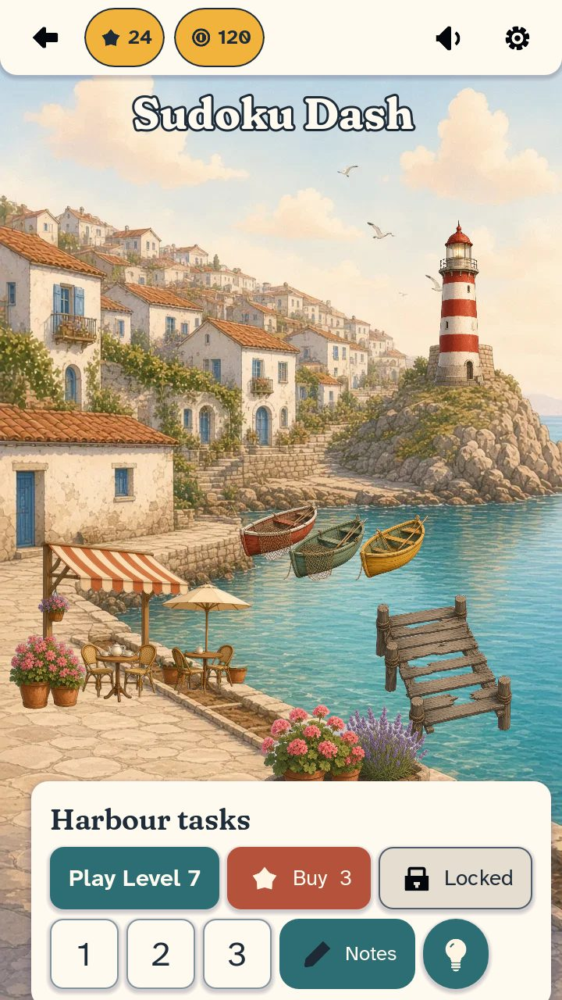

# Sudoku Dash — Art Style Guide & Kit v1 (for Build and Design)

Status: art direction **approved 2026-10-24**. Kit v1 lives in `assets/art/` on branch `art/assets-v1`. **Not wired into any scene yet.** Integration waits for the portrait/mobile layout pass on `dev`.
Overview: [contact_sheet_v1.jpg](contact_sheet_v1.jpg) · Real Godot render of theme and sprites: [theme_preview_v1.jpg](theme_preview_v1.jpg) · Direction: [ART_DIRECTION_PROPOSAL.md](ART_DIRECTION_PROPOSAL.md) · Licenses: [LICENSES.md](LICENSES.md)



## 1. Folder map
```
assets/art/
  art_palette.gd              # class_name ArtPalette: colour constants, font/icon/sprite paths, digit ratios
  theme/sudoku_dash_theme.tres # Godot 4.3 Theme (generated by tools/art/build_theme.gd; do not hand-edit)
  fonts/                      # 5 subset TTFs + OFL texts
  icons/icon_<name>_<variant>.png
  harbour/harbour_bg_{portrait,landscape}.webp
  harbour/task_<id>_{unrestored,restored}.webp
  harbour/harbour_layout_portrait.json  # suggested sprite positions on the portrait bg
tools/art/  build_theme.gd, theme_preview.gd, gen_palette.py   (export-excluded)
docs/art/   this guide, licenses, mood board, helper scripts      (gdignored)
```

## 2. Palette (source of truth: `docs/art/palette.json` → `ArtPalette`)
| Constant | Hex | Use |
|---|---|---|
| `BG_LINEN` | #F4EBDC | Screen background behind panels |
| `PANEL_CREAM` | #FFFAF0 | Panels, modals, keypad tiles, text on teal/terracotta |
| `GRID_CELL` | #FFFDF8 | Cell paper |
| `GRID_LINE_THIN` / `GRID_LINE_BOX` | #82959F / #2E4A5C | Cell lines (2px) / box lines and border (4px) |
| `DIGIT_GIVEN` | #1E2B38 | Givens, using **AHN Bold** |
| `DIGIT_PLAYER` | #1A4FA3 | Player digits, using **AHN Medium** |
| `DIGIT_NOTES` | #4E5D69 | Pencil notes, using AHN Regular |
| `HL_SELECTED` / `HL_PEER` / `HL_SAME` | #FFE3A3 / #EDF2F1 / #B9D9E6 | Selected cell / row-col-box / same digit |
| `ERROR_INK` / `ERROR_CELL` | #A3211A / #F9D9D3 | Wrong digit (add a 3px underline and shake; never colour alone) |
| `ACCENT_TEAL` (+`_HOVER` #286469, `_PRESSED` #235A5E) | #2C6E73 | Primary buttons |
| `ACCENT_TERRACOTTA` (+`_HOVER` #A84B35, `_PRESSED` #9A4431) | #B5523B | Secondary, Buy, rewarded |
| `STAR_GOLD` | #F2B33D | Stars, coins, currency pills (ink text or outline) |
| `BTN_DISABLED` | #E4DDD0 | Locked/disabled (ink text and lock icon) |
| `TEXT_INK` | #1E2B38 | Body text |
| Village tones | see palette.json | sky #BFE3EF (boot/splash bg stays), sea, sand, whitewash, terracotta, shutter blue, sage, lavender, geranium, wood, lilac shadow #5B5470 |

Contrast (WCAG):
- Digits on cells and highlights: **≥ 4.9:1** everywhere. Givens are 14.2:1 and player digits 7.7:1 on a plain cell.
- Cream text on teal: 5.6:1 normal, 6.5:1 hover, 7.5:1 pressed.
- Cream text on terracotta: 4.8:1 normal, 5.4:1 hover, 6.2:1 pressed.
- Ink on gold: 7.7:1. Ink on disabled: 10.7:1.
- Full table: ART_DIRECTION_PROPOSAL.md §2.

## 3. Fonts
| Role | File | Theme use |
|---|---|---|
| Title / big headers | `Fraunces-BoldSoft.ttf` (700) | `LabelTitle` 56px |
| Section headers | `Fraunces-SemiBoldSoft.ttf` (600) | `LabelHeader` 38px |
| Body, default | `AtkinsonHyperlegibleNext-Regular.ttf` | `default_font`, 28px |
| Small and notes | `AtkinsonHyperlegibleNext-Medium.ttf` | `LabelSmall` 22px, player digits |
| Buttons, givens, emphasis | `AtkinsonHyperlegibleNext-Bold.ttf` | Buttons 30px, `LabelStrong`, `LabelPill` |

- **Grid digits:** size = `ArtPalette.DIGIT_SIZE_RATIO` (0.70) × cell height. Notes = 0.26 × cell height.
- **Font setup:** load via `load(ArtPalette.FONT_UI_BOLD)`. Turn on `FontFile` MSDF only if digits are scaled by large factors at runtime. The default import is fine at 1:1.
- **Glyph coverage:** Latin-1 plus common punctuation, € and arrows. There is **no ★ glyph**; use the star icon. If localisation needs more scripts, regenerate the subsets (§9).

## 4. Theme usage (`res://assets/art/theme/sudoku_dash_theme.tres`)
Set it once on the root Control (`root.theme = load(ArtPalette.THEME_PATH)`) or as the project default theme (`gui/theme/custom`). Then choose looks with `theme_type_variation`:

| Variation | Base | Look | Use |
|---|---|---|---|
| *(none)* | Button | Teal, cream bold text | Primary: Play, Resume, Continue |
| `ButtonSecondary` | Button | Terracotta | Buy, rewarded, secondary CTA |
| `ButtonLocked` | Button | Disabled fill, ink text, notes-grey border | Locked tasks/levels. Add `icon_lock_ink` |
| `ButtonTile` | Button | Cream tile, ink 44px bold, thin border. Hover = peer tint, pressed = butter | Number pad keys |
| `ButtonChip` | Button | Cream pill with teal border. `toggle_mode` pressed = teal and cream | Tier chips (T1-T4), Notes ON/OFF |
| `ButtonIcon` | Button | Round teal | Hint, primary icon actions (`*_cream` icons) |
| `ButtonIconFlat` | Button | Transparent, ink, round hover | Top bar: back, sound, settings (`*_ink` icons) |
| `PanelContainer` / `Panel` | | Cream, radius 22, lilac shadow | Cards, task list |
| `PanelModal` | PanelContainer | Radius 28, bigger shadow, 32px padding | Pause, hint, out-of-mistakes, results |
| `PanelTopBar` | PanelContainer | Cream bar, rounded bottom corners | Header |
| `PanelPill` | PanelContainer | Gold pill with ink border | Stars, coins and tokens counters (icon + `LabelPill`) |
| `PanelScrim` | Panel | Lilac at 55% | Dim behind modals |
| `LabelTitle` / `LabelHeader` / `LabelBody` / `LabelStrong` / `LabelSmall` / `LabelPill` / `LabelOnAccent` / `LabelError` | Label | see §3 | |
| ProgressBar, TooltipPanel, HSeparator, VScrollBar | | Palette-styled | |

- The focus ring is a 4px gold outline on every button, for keyboard and controller users.
- **Layout-agnostic:** the theme sets no sizes, anchors or containers. Only colours, fonts, radii and padding.
- **Touch targets:** the theme gives roughly 64px-tall buttons at 30px text. For key tiles and icon buttons, set `custom_minimum_size` ≥ `ArtPalette.MIN_TOUCH` (88px at a 720-wide portrait base, about 48dp).
- **Changing colours:** edit `docs/art/palette.json`, run `python3 tools/art/gen_palette.py`, then `godot --headless --path . -s tools/art/build_theme.gd`.
- **Visual check:** `xvfb-run -a -s "-screen 0 1400x2400x24" godot --path . --resolution 1280x2276 -s tools/art/theme_preview.gd -- out=/tmp/p.png`. It renders the 720x1280 preview at the top-left.

## 5. Icons
`assets/art/icons/icon_<name>_<variant>.png`, 100x100, white-on-alpha recoloured.
- **Names:** `star, coin, settings, sound_on, sound_off, undo, hint, notes, erase, lock, back`
- **Variants:** `ink` (on cream or light surfaces), `cream` (on teal or terracotta), plus `gold` for `star` and `coin` only.
- **Path helper:** `ArtPalette.icon_path("hint", "cream")`.
- **Display size:** 36–48px (the theme caps button icons at 48px via `icon_max_width`).

## 6. Harbour scene and task sprites
- **Backgrounds:**
  - `harbour_bg_portrait.webp` (720x1280, native generation) is the primary background for the upcoming portrait layout.
  - `harbour_bg_landscape.webp` (1280x720) is the matching landscape and desktop version.
  - Use `TextureRect` with `STRETCH_KEEP_ASPECT_COVERED` so either one crops to any aspect ratio.
  - Both backgrounds have **deliberately empty slots**: the stone plinth on the headland, open water, the lower-left quay corner, the soil strip along the quay edge and the lower-right jetty edge.
- **Task sprites:** `task_<id>_<state>.webp`, transparent, trimmed with 4px padding.
  - `id` ∈ `dock, boats, flowers, lighthouse, cafe` (matches `game/profile.gd` TASKS ids).
  - `state` ∈ `unrestored, restored`.
  - **Always show exactly one state per task:** unrestored until bought, then restored.
  - Path helper: `ArtPalette.task_sprite_path(id, restored)`.
- **Placement:** start from `harbour_layout_portrait.json` (positions and scale on the 720x1280 background, tested in `theme_preview.gd`). Fine-tune during integration. The lighthouse sits on the plinth, the dock on the right-hand harbour edge, the boats on the water, the café in the lower-left corner and the flowerbeds on the soil strip.
- **Restore moment (suggested):** cross-fade unrestored → restored (0.4s), scale punch 1.0 → 1.06 → 1.0, a few gold sparkles (`STAR_GOLD`), a soft chime.
- **Decor choices:** `profile.gd` decor variants (Blue planks, Lavender, Blue stripes and so on) are **not in v1**. Default looks: dock = oak planks with rope posts, boats = red, sea green and yellow, flowers = geranium and lavender, lighthouse = red stripes, café = striped awning and parasols. Variants can follow in v2 as recolours or regenerations.

## 7. Sprite naming and adding new art
- Use lower_snake_case: `<category>_<subject>_<state>.<ext>`, for example `task_bakery_restored.webp` or `icon_shop_ink.png`.
- **Generated art:** use the locked prompt prefix (proposal §5) with `02_harbour_village.jpg` as the reference. Generate before and after together in one image, on a flat #D9D9D9 background. Then cut out with `docs/art/tools/cutout.py` and finish with `finalize_sprites.py`. Add a row to LICENSES.md.
- Keep raw and source files **outside** `res://` (or in a folder with a `.gdignore`).

## 8. Import settings and size budget
- **Harbour WebPs:** `compress/mode=1` (Lossy), `lossy_quality=0.85`, no mipmaps, `fix_alpha_border=true`. These are already committed in the `.import` files.
  - Don't switch to Lossless: that took the harbour folder from 0.68 MB to 3.3 MB.
  - Don't use VRAM compression on the web: it's bigger and blurrier for 2D.
- **Icons:** default Lossless (tiny). **Fonts:** default import.
- **Measured (Godot 4.3 Web export, `--export-release "Web"`):**
  - `dev` pck: 3,661,616 B. `art/assets-v1` pck: 4,495,520 B.
  - **The kit adds +833,904 B (≈0.83 MB)**, against a 5 MB budget.
  - Total web build went from 39.39 MB to 40.23 MB (the wasm is 35.4 MB and unchanged).
- **Source file sizes:**
  - harbour: 0.69 MB (backgrounds 0.32 MB, 10 sprites 0.37 MB)
  - fonts: 0.16 MB
  - icons: 0.05 MB
  - theme: 0.04 MB

## 9. Regenerating fonts (if glyphs are missing)
```
fonttools varLib.instancer Fraunces[SOFT,WONK,opsz,wght].ttf wght=700 opsz=48 SOFT=100 WONK=0 -o fr700.ttf
pyftsubset fr700.ttf --unicodes="U+0020-007E,U+00A0-00FF,U+0131,U+0152-0153,U+02C6,U+02DA,U+02DC,U+2013-2014,U+2018-201A,U+201C-201E,U+2022,U+2026,U+2030,U+2039-203A,U+20AC,U+2122,U+2190-2193,U+2212,U+00D7,U+FEFF,U+FFFD" --layout-features='kern,liga,lnum,tnum,case' --name-IDs='*' --output-file=assets/art/fonts/Fraunces-BoldSoft.ttf
```
AHN: `fonttools varLib.instancer AtkinsonHyperlegibleNext[wght].ttf wght=500 -o ahn500.ttf`, then the same subset command. Keep `--name-IDs='*'` so the OFL notice stays inside the font.


## 10. In-game integration (art/integrate-v1)
- `ui/main.gd` sets the kit theme on the root Control; screens pick looks with `theme_type_variation` only
  (primary = default teal Button, `ButtonSecondary` = Hint / Buy / rewarded, `ButtonChip` = Back, Settings, tiers,
  Notes (toggle), Undo, Erase, decor, `ButtonTile` = digit pad, `ButtonLocked` + lock icon = locked tasks).
  Sizes, containers and the 88 / 56 unit touch minimums are unchanged; button content margins are 14 x 8 so labels
  never clip in the 4-up portrait tool row. Icons are left off the portrait tool row for the same reason.
- Panels/modals reuse the `PanelModal` stylebox with the layout's own content margin; the scrim is lilac ink.
- Headings use Fraunces (`_heading()`), body/UI Atkinson Hyperlegible Next. Results show 3 star icons + the text.
- Grid (`ui/grid_view.gd`): ArtPalette colours, given = AHN Bold, player = AHN Medium, notes = AHN Regular,
  digits 0.68 x cell, wrong digits are ERROR_INK + underline + shake (never colour-only), teach step = soft sage.
- Harbour (`ui/harbour_view.gd`): portrait or landscape background chosen by the view's aspect (>= 1.35 = landscape),
  cover-cropped and centred on the task sprites; if a short/wide rect cannot show every sprite while covering, it
  zooms out just enough and fills the edge with a mirrored copy of the art. Sprites swap unrestored -> restored by
  `profile.tasks`; a newly bought task cross-fades in over 1.1 s with a gold ring. Decor choices beyond the first are
  a gentle tint for now (dedicated decor sprites = kit v2).
- Menus (title, settings, results, area restored) sit on the harbour background; grid + harbour list on linen.
